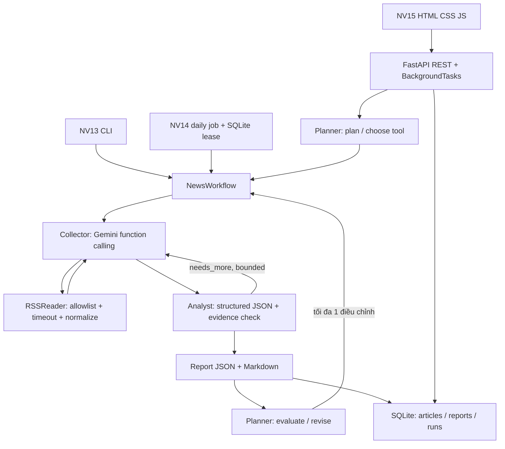

# Hướng dẫn triển khai

## Kiến trúc và luồng dữ liệu

`shared/config.py` đọc `.env` và kiểm tra mode. `shared/rss.py` chuẩn hóa HTML, URL, thời gian UTC, chống trùng URL/tiêu đề. `shared/llm.py` cung cấp hai provider tách biệt; mock mô phỏng chứ không phải LLM. `agents.py` điều phối feedback và kiểm tra quote; `service.py` thực thi kế hoạch; `storage.py` dùng transaction SQLite.

## Triển khai trên Windows

1. Cài Python 3.11+, vào root repository.
2. Chạy `scripts/setup.ps1` hoặc lệnh thủ công trong README. Nếu PowerShell chặn script, dùng các lệnh thủ công; không cần đổi policy máy.
3. `.env` mặc định mock, không chứa key. Chạy cả ba entrypoint riêng trong README.
4. Khi cần live, chỉnh `.env` trên máy; không đưa key vào Git hay minh chứng. Khởi động lại web sau đổi cấu hình.
5. Kiểm tra `logs/agents.log`, báo cáo JSON/Markdown và Swagger.

## Cấu hình

| Biến | Mặc định | Ý nghĩa |
|---|---|---|
| APP_MODE | mock | mock hoặc live; CLI `--mode` ghi đè |
| GEMINI_API_KEY | trống | bắt buộc khi live |
| GEMINI_MODEL | gemini-flash-latest | model có hỗ trợ tools/structured JSON |
| HTTP_TIMEOUT | 20 | timeout HTTP/SDK (giây) |
| MAX_API_CALLS | 16 | số request model tối đa mỗi execution |
| MAX_STEPS | 8 | số quyết định tool mỗi Collector |
| MAX_ROUNDS | 2 | số vòng Collector/Analyst mỗi workflow |
| DATA_DIR | data | thư mục SQLite, tương đối với root |
| REPORT_DIR | reports | thư mục báo cáo, tương đối với root |

Planner có tối đa 2 kế hoạch, chung một API budget. SDK không retry tự động. Nếu budget hết trước báo cáo đầu tiên, lượt chạy thất bại; nếu đã có báo cáo, web giữ báo cáo gần nhất và đánh dấu incomplete. Chủ đề từ 1-300 ký tự; số bài 1-20. API request ngôn ngữ tự nhiên tối đa 1000 ký tự.

## NV13

Collector biết danh sách nguồn, bài đã nhận và nguồn đã thử. Model quyết định đọc nguồn hoặc kết thúc chọn các article ID liên quan. Tool bị giới hạn allowlist, không thực thi shell hay URL tùy ý. Analyst nhận bài, trả findings/category/summary/evidence_quote/needs_more. Coordinator có thể gọi lại Collector với followup_topic. Báo cáo có trace và số lượt model; thiếu bài không được bịa thêm.

Exit code CLI: `0` đủ kết quả, `2` thiếu bài/căn cứ, `1` lỗi. Log ghi agent/action; console Windows có thể hiển thị dấu lỗi với encoding mặc định, file log vẫn UTF-8. Có thể dùng `$env:PYTHONUTF8='1'` trong PowerShell hiện tại.

## NV14

Khóa daily dùng ngày theo `Asia/Ho_Chi_Minh`, mode và hash chủ đề. `BEGIN IMMEDIATE` đảm bảo một chủ sở hữu; job done hoặc lease đang hiệu lực bị bỏ qua. Failed/incomplete được retry. Crash giữ lease đến khi hết hạn; lease tính theo timeout/budget, mặc định ít nhất một giờ. Không đổi chủ đề để vượt khóa cho cùng công việc.

Lưu cả JSON và Markdown trước đánh dấu done. Mỗi file dùng temp + replace; hai file và SQLite không phải một transaction filesystem chung, crash có thể để lại file chưa được đánh dấu done. Retry tạo report ID mới, không làm mất báo cáo cũ.

Script Task Scheduler trong NV14 chỉ đăng ký khi người dùng chạy. Lịch 08:00 theo múi giờ Windows; kiểm tra máy đang dùng giờ Việt Nam nếu muốn 08:00 Việt Nam. Principal chỉ chạy khi tài khoản đăng nhập, không cần admin, không ghi đè task đã tồn tại. Máy ngủ/tắt: `StartWhenAvailable` hỗ trợ chạy bù khi có thể, không bảo đảm đúng 08:00 nếu máy không hoạt động.

## NV15

REST API:

| Method | Endpoint | Mục đích |
|---|---|---|
| GET | /api/config | mode, model, giới hạn (không có key) |
| POST | /api/runs | body `{"request":"Tổng hợp 5 tin về AI"}`, trả 202 + ID |
| GET | /api/runs | 50 lượt gần nhất |
| GET | /api/runs/{id} | trạng thái, trace, report ID, lỗi |
| GET | /api/reports/{id} | báo cáo JSON |
| GET | /api/reports/{id}/download?format=md | tải Markdown (hoặc json) |

Frontend poll mỗi giây; render dữ liệu bằng textContent, chỉ tạo link HTTP/HTTPS. Một lượt active tại một thời điểm, request tiếp theo trả 409. Trạng thái: queued, running, completed, incomplete, failed. Chạy một server/worker cho cùng database; startup recovery dùng giả định đó. BackgroundTasks không phải durable queue; restart không tự tiếp tục chạy Agent.

## Kiểm tra và xử lý lỗi

- Thiếu key ở live: thêm vào `.env` hoặc chọn `--mode mock` rõ ràng.
- RSS timeout/HTTP lỗi: xem source_error trong trace; model có thể thử nguồn khác.
- Gemini quota/model/schema lỗi: lượt chạy failed, xem loại lỗi; kiểm tra tài khoản/model, không sửa thành dữ liệu demo trong live.
- Không đủ bài: xem incomplete và limitation; thử chủ đề phù hợp nguồn hoặc giảm count.
- Cổng bận: dùng `--port 8001`.
- Crash web: khởi động lại server duy nhất, lượt dang dở chuyển failed; gửi yêu cầu mới.
- Warning Starlette TestClient: cảnh báo tương thích test, không phải thất bại; giữ lock đã kiểm thử, đánh giá lại khi nâng dependencies.

Không có login, thanh toán hay cloud deploy. App bind loopback cho mục đích local. Không tự đăng ký task hoặc sửa cấu hình hệ thống.
